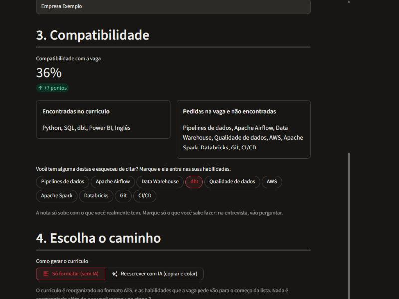
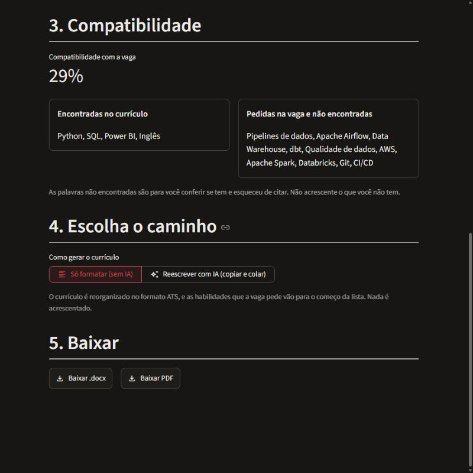
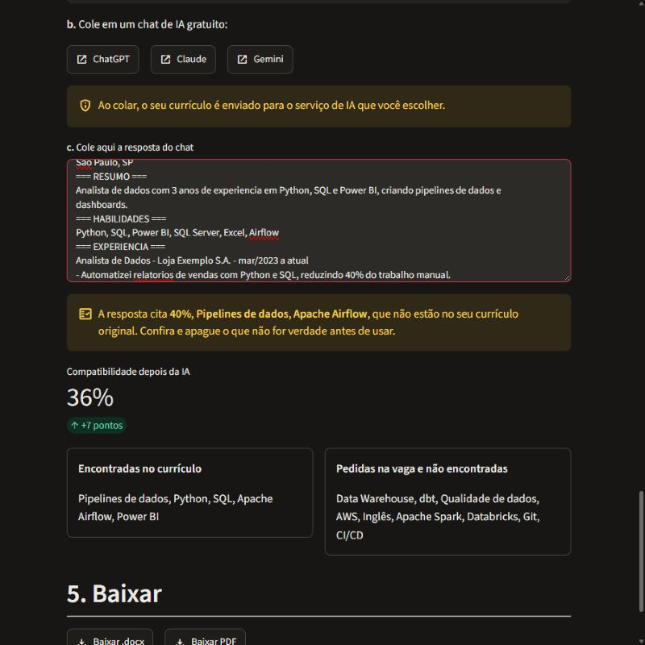

# Currículo ATS

Adapte o seu currículo a uma vaga e gere uma versão que os sistemas de seleção automática (ATS) conseguem ler. É gratuito, roda no seu computador e não precisa de cadastro nem de chave de API.



**Com ele você:**

- vê uma **nota de compatibilidade** entre o seu currículo e a vaga, com as palavras-chave encontradas e as que faltam;
- gera o currículo em **Word (.docx) e PDF**, num formato simples que os ATS leem sem erro;
- pode, se quiser, **reescrever o texto com um chat de IA gratuito** (ChatGPT, Claude ou Gemini) usando um prompt pronto, e o app **confere se a IA inventou algo**.

---

## Sumário

1. [O que é um ATS e por que o formato importa](#o-que-é-um-ats-e-por-que-o-formato-importa)
2. [Passo a passo para instalar (para quem nunca programou)](#passo-a-passo-para-instalar)
3. [Como usar](#como-usar)
4. [Reescrever com IA sem pagar nada](#reescrever-com-ia-sem-pagar-nada)
5. [Privacidade](#privacidade)
6. [Perguntas frequentes e problemas comuns](#perguntas-frequentes-e-problemas-comuns)
7. [Para desenvolvedores](#para-desenvolvedores)
8. [Próximos passos](#próximos-passos)
9. [Autor e licença](#autor-e-licença)

---

## O que é um ATS e por que o formato importa

ATS (*Applicant Tracking System*) é o sistema que muitas empresas usam para receber candidaturas. Antes de uma pessoa ler o seu currículo, ele:

1. **lê o arquivo** e tenta separar nome, experiências, formação e habilidades;
2. **procura as palavras-chave da vaga** (por exemplo, "SQL", "Power BI", "inglês avançado");
3. **ordena os candidatos**, e quem aparece no topo tem mais chance de ser chamado.

Currículos com duas colunas, tabelas, ícones, fotos ou texto dentro de imagens costumam ser lidos errado: o sistema mistura as informações ou nem as encontra. Por isso este app gera um currículo **simples de propósito**: uma coluna, fonte padrão, títulos claros e nenhum enfeite.

> Este app **não inventa nada**. Ele reorganiza o que você já escreveu e mostra o que a vaga pede. Se faltar uma palavra-chave que você realmente domina, acrescente. Se você não tem aquela experiência, não acrescente: a entrevista vai perguntar.

---

## Passo a passo para instalar

São três passos, e você só faz isso uma vez.

### Passo 1: instalar o Python

O app é feito em Python, um programa gratuito. **Instale o Python 3.13** (o app também funciona com o 3.11 e o 3.12). Se você já tem uma dessas versões, pule para o passo 2.

> **Por que não a versão mais nova?** Logo depois que sai uma versão nova do Python, algumas bibliotecas ainda não têm pacotes prontos para ela, e a instalação falha pedindo um "compilador C++". Se você já tem uma versão mais nova instalada, tudo bem: instale a 3.13 também. Elas convivem, e o `iniciar.bat` escolhe a 3.13 sozinho.

**No Windows**

1. Abra <https://www.python.org/downloads/windows/>.
2. Procure a versão **Python 3.13** mais recente da lista (por exemplo, 3.13.9) e clique em **Windows installer (64-bit)**.
3. Abra o arquivo baixado.
4. **Importante:** na primeira tela, marque a caixa **"Add python.exe to PATH"** (fica embaixo). Sem isso o app não encontra o Python.
5. Clique em **Install Now** e espere terminar.

**No Mac**

1. Abra <https://www.python.org/downloads/macos/>.
2. Procure a versão **Python 3.13** mais recente e clique em **macOS 64-bit universal2 installer**.
3. Abra o arquivo `.pkg` e siga as telas até o fim.

**No Linux:** o Python já vem instalado na maioria das distribuições. Confira com `python3 --version`.

### Passo 2: baixar o projeto

1. No topo desta página do GitHub, clique no botão verde **Code**.
2. Clique em **Download ZIP**.
3. Encontre o arquivo `curriculo-ats-main.zip` na pasta Downloads, clique com o botão direito e escolha **Extrair tudo** (no Mac, basta dar dois cliques).

Você vai ter uma pasta chamada `curriculo-ats-main`. Pode movê-la para onde quiser, como Documentos.

### Passo 3: abrir o app

**No Windows:** abra a pasta `curriculo-ats-main` e dê **dois cliques em `iniciar.bat`**.

- Se aparecer um aviso azul "O Windows protegeu o computador", clique em **Mais informações** e depois em **Executar assim mesmo**. O aviso aparece porque o arquivo veio da internet.
- Na **primeira vez**, uma janela preta instala o que o app precisa. Isso leva de 2 a 5 minutos.
- Depois, o app abre sozinho no seu navegador. Nas próximas vezes, abre em segundos.
- **Para fechar o app, feche a janela preta.**

**No Mac ou Linux:** abra o Terminal, entre na pasta e rode:

```bash
cd ~/Downloads/curriculo-ats-main
chmod +x iniciar.sh
./iniciar.sh
```

O navegador abre em `http://localhost:8501`. Para fechar, pressione `Ctrl + C` no Terminal.

---

## Como usar

A página tem cinco etapas, de cima para baixo. Quer só experimentar? Clique em **Usar o exemplo** e o app carrega um currículo e uma vaga fictícios.

**1. Seu currículo.** Envie o arquivo em PDF ou Word (.docx). O app separa o texto em seções (Contato, Resumo, Experiência...). Abra **"Confira as seções que reconheci"** para corrigir o que tiver ido para o lugar errado.

**2. A vaga.** Copie a descrição da vaga do site (LinkedIn, Gupy, site da empresa) e cole no campo. O nome da empresa é opcional e serve só para nomear o arquivo.

**3. Compatibilidade.** O app mostra:

- a **nota**: quantas palavras-chave da vaga aparecem no seu currículo;
- as palavras **encontradas**;
- as palavras **pedidas na vaga e não encontradas**.

Logo abaixo, cada palavra não encontrada vira um botão. **Você tem aquela habilidade e esqueceu de citar? Clique nela.** Ela entra nas suas habilidades e a nota sobe na hora, sem IA nenhuma. Não tem? Deixe sem marcar.

> **A nota só sobe com o que você realmente tem.** O app nunca acrescenta nada por conta própria: só o que você marcar. Marque só o que você sabe fazer, porque a entrevista vai perguntar.

**4. Escolha o caminho.**

- **Só formatar (sem IA):** reorganiza o seu currículo no formato ATS e coloca no começo das habilidades as que a vaga pede. É instantâneo e não envia nada para lugar nenhum.
- **Reescrever com IA (copiar e colar):** veja a [próxima seção](#reescrever-com-ia-sem-pagar-nada).

**5. Baixar.** Baixe em **.docx** (para editar no Word ou no Google Docs) ou **PDF** (para enviar).



---

## Reescrever com IA sem pagar nada

Este caminho usa um chat de IA gratuito que você já conhece para melhorar a escrita das frases. Não é preciso ter chave de API.

1. Na etapa 4, escolha **Reescrever com IA (copiar e colar)**.
2. Clique no ícone de copiar no canto do quadro com o prompt.
3. Clique em um dos botões (ChatGPT, Claude ou Gemini), entre na sua conta gratuita e cole o prompt na conversa.
4. Copie a resposta inteira do chat e cole no campo **"Cole aqui a resposta do chat"**.
5. O app separa a resposta em seções, em campos que você pode editar (**"Confira e edite o currículo reescrito"**).
6. O app **confere se a IA acrescentou números, tecnologias ou contatos que não estavam no seu currículo**. Se acrescentou, aparece um aviso amarelo listando o quê. Apague nos campos o que não for verdade: o aviso some quando não sobrar nada inventado.
7. Veja a nova nota de compatibilidade e baixe o arquivo. O arquivo usa o que estiver nos campos editáveis.



O prompt já pede para a IA não inventar nada, mas IAs às vezes inventam mesmo assim. Por isso a conferência existe. **Leia o currículo final antes de enviar.**

**Sobre o prompt:**

- Ele sai **inteiro no idioma da vaga**. Para uma vaga em inglês, instruções, marcadores e currículo vêm em inglês, e a IA traduz o seu currículo sem mudar o sentido. Misturar idiomas confunde as IAs mais simples.
- Ele lista as palavras-chave da vaga que você já tem e pede que a IA as escreva **exatamente como a vaga escreve** (por exemplo, "Pipelines de dados" em vez de "fluxos de dados"). É assim que uma reescrita honesta ganha pontos.

**A nota não subiu depois da IA?** É esperado quando faltam habilidades que você não tem: a IA melhora o texto, mas não pode acrescentar experiência. Para a nota subir, marque na etapa 3 o que você tem e esqueceu de citar. O resultado também varia de uma IA para outra; se a resposta vier estranha, tente outro chat.

---

## Privacidade

- O app roda **só no seu computador**. O seu currículo não é enviado para nenhum servidor deste projeto (não existe servidor).
- As estatísticas de uso do Streamlit estão **desligadas** (`.streamlit/config.toml`), e o app só aceita conexões do próprio computador.
- Nada é salvo: ao fechar o app, tudo some. Ficam só os arquivos que você baixou.
- **Exceção:** no caminho com IA, **você** cola o seu currículo no chat que escolher. A partir daí valem as regras de privacidade daquele serviço. Se preferir, apague telefone e endereço do prompt antes de colar.

---

## Perguntas frequentes e problemas comuns

**A janela diz "Python 3.11 ou mais novo não foi encontrado".**
O Python não está instalado ou foi instalado sem marcar "Add python.exe to PATH". Instale de novo pelo [passo 1](#passo-1-instalar-o-python) e marque a caixa. Depois feche e abra o `iniciar.bat` de novo.

**A instalação falhou com "Microsoft Visual C++ 14.0 or greater is required" ou "Failed to build".**
O seu Python é novo demais e alguma biblioteca ainda não tem pacote pronto para ele. Instale o Python 3.13 (veja o [passo 1](#passo-1-instalar-o-python)), apague a pasta `.venv` dentro do projeto e abra o `iniciar.bat` de novo.

**Digitei `python` e abriu a Microsoft Store.**
Isso é um atalho do Windows, não o Python de verdade. Instale pelo site python.org, conforme o passo 1.

**A janela preta fecha sozinha ou mostra "Falha na instalação".**
Confira a internet: a primeira execução baixa as bibliotecas. Se continuar, apague a pasta `.venv` dentro do projeto (ela fica oculta) e abra o `iniciar.bat` de novo.

**"Não encontrei texto neste arquivo".**
O PDF provavelmente é uma imagem escaneada. Abra o currículo no Word ou no Google Docs e salve como .docx ou como PDF, ou envie o .docx original.

**O navegador não abriu sozinho.**
Abra o navegador e digite `http://localhost:8501`.

**A nota está baixa. Devo colocar todas as palavras que faltam?**
Não. A nota é um guia, não uma meta. Marque na etapa 3 só o que você realmente sabe fazer. Um currículo honesto com 60% passa melhor por uma entrevista do que um inflado com 100%.

**As seções foram separadas errado.**
Abra "Confira as seções que reconheci" na etapa 1 e mova o texto para o campo certo. O currículo final usa o que estiver nesses campos.

**O currículo está em português e a vaga em inglês.**
No caminho sem IA o texto não é traduzido. Use o caminho com IA: o prompt inteiro sai no idioma da vaga e pede a tradução do currículo.

---

## Para desenvolvedores

```bash
git clone https://github.com/ArthurTheWorld/curriculo-ats.git
cd curriculo-ats
python -m venv .venv
# Windows: .venv\Scripts\activate   |   Mac/Linux: source .venv/bin/activate
pip install -r requirements.txt -r requirements-dev.txt
pytest                      # testes (não precisam de rede)
streamlit run app.py        # abre o app
```

**Estrutura**

```
app.py                     interface (Streamlit): só orquestra os módulos abaixo
curriculo_ats/
  leitura.py               texto de PDF e .docx
  secoes.py                divide o currículo em seções (títulos em PT e EN)
  idioma.py                detecta português ou inglês; títulos de cada idioma
  palavras_chave.py        dicionário de termos, nota de compatibilidade
  prompt.py                prompt do modo copiar e colar
  resposta.py              lê a resposta colada do chat
  conferencia.py           aponta números, termos e contatos novos na resposta
  exportar.py              gera .docx e PDF no layout ATS
dados/termos.yaml          dicionário de palavras-chave (edite à vontade)
exemplos/                  currículo e vaga fictícios (usados nos testes e no botão de exemplo)
tests/                     pytest, incluindo testes da interface com AppTest
```

**Acrescentar palavras-chave.** Edite `dados/termos.yaml`. Cada termo tem `nome`, `sinonimos` (opcional) e `categoria`. Para nomes ambíguos (como a linguagem "Go"), use `so_sinonimos: true` e liste só formas sem ambiguidade ("Golang"). Rode `pytest` depois: um teste garante que não há nomes duplicados.

**Contribuir.** Issues e pull requests são bem-vindos. Mantenha a regra de ouro: o código nunca acrescenta conteúdo ao currículo de ninguém.

---

## Próximos passos

- IA rodando no próprio computador com [Ollama](https://ollama.com), para reescrever sem colar em chat nenhum
- Interface e currículo em mais idiomas (espanhol)
- Carta de apresentação a partir da mesma vaga
- README em inglês

---

## Autor e licença

Feito por **Luiz Arthur**, engenheiro de dados.
[LinkedIn](https://www.linkedin.com/in/luiz-arthur-/) · [GitHub](https://github.com/ArthurTheWorld)

Licença [MIT](LICENSE): use, modifique e compartilhe à vontade.
